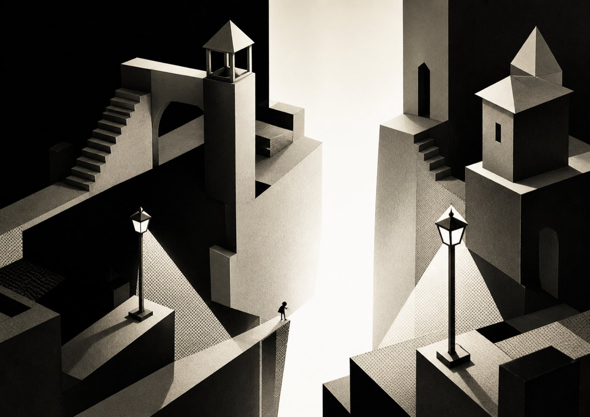
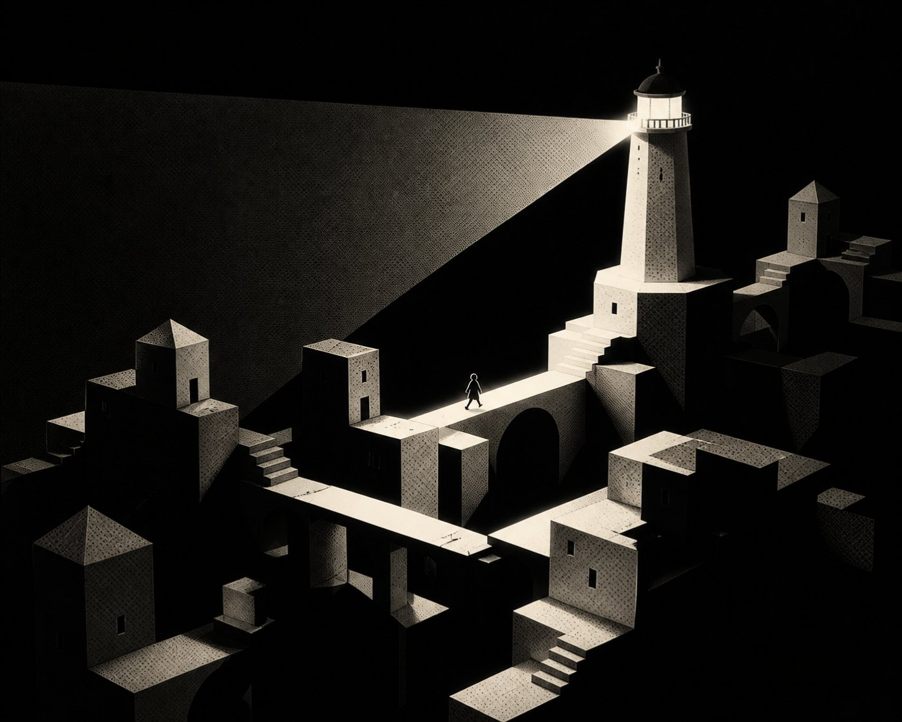
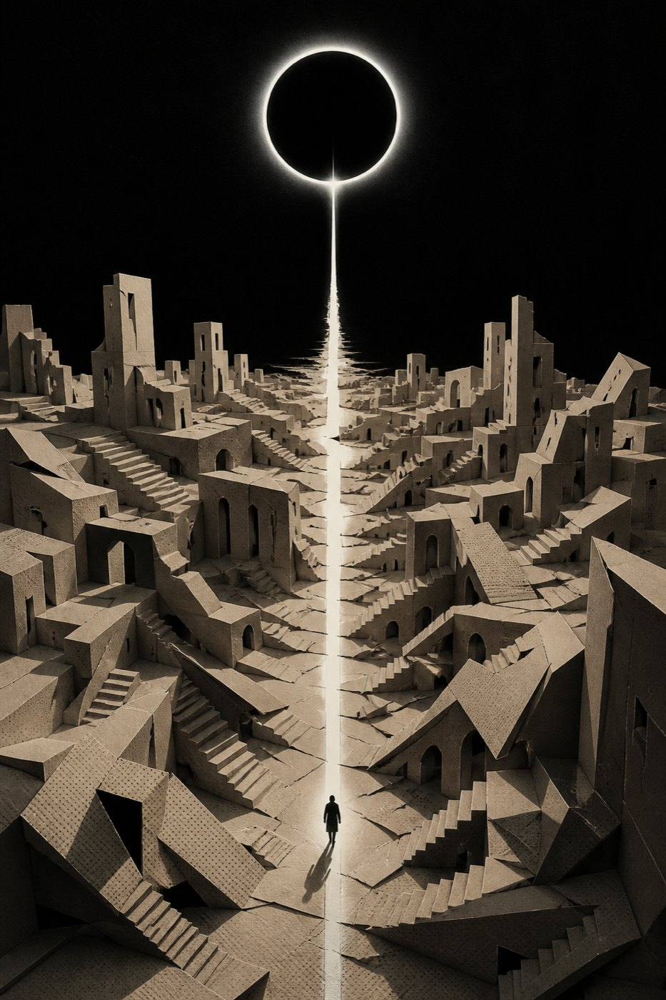

<p align="center">
  
</p>

<h1 align="center">蚀线</h1>

<p align="center">一款黑白纸雕风格的光影解谜游戏</p>

## 简介

穿过一座只存在于光影交界处的纸雕城市：没有灯的地方会坠落，被两盏灯同时照亮的地方同样危险，只有恰好被一盏灯照到的「蚀线」能够承重。

## 玩法

- 转动路灯、推开遮光箱、拾起提灯，或把自己的影子钉在纸面上，让它冻结成桥、压住机关，甚至替你走进暗处。
- 十个短关卡逐步引入遮挡、折光、移动灯塔与日轮终局；每次操作都会让整座纸城重新显影。
- 支持键鼠、触屏与标准手柄；带自动检查点、章节选择、提示、减少闪白和跨会话进度。

**操作**：WASD / 方向键移动，E 互动，空格钉住/收回影子，Q / C 切换视角，F 近观，H 查看目标，R 重开本关，Esc 暂停。

## 画面

<p align="center">
  
  
</p>
<p align="center">
  
  
</p>

## 技术栈

- Three.js —— 通过 `index.html` 中的 importmap 指向本地 `vendor/three.module.js`，无需联网或安装。
- 原生 ES Module（`src/main.js`），无构建步骤。

## 运行

因使用 ES Module，需通过静态服务器访问（不能 `file://` 直开）：

```bash
python3 -m http.server 8000
```

浏览器打开 http://localhost:8000/ 。

附带的开发脚本：

```bash
node --test tests/*.test.js     # 单元测试
python3 scripts/gen-art.py      # 生成美术资源
node scripts/pack-dist.cjs      # 打包发布
```

## 目录结构

```
eclipse-line/
├── index.html          入口（含 three 的 importmap）
├── src/                源码：main.js、engine、world、player、ui、fx、audio、content、input、save
├── assets/             图片与美术素材
├── docs/               发布资料与画面截图
├── vendor/three.module.js
├── styles.css
├── tests/              单元测试
└── scripts/            美术生成与打包脚本
```

## 说明

- 版权与许可：作者保留所有权利（未声明开源协议）。
